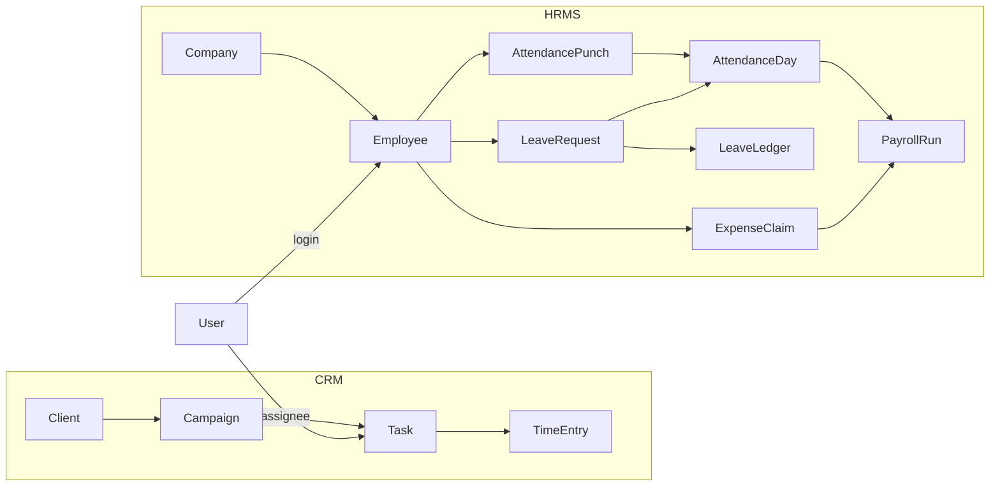
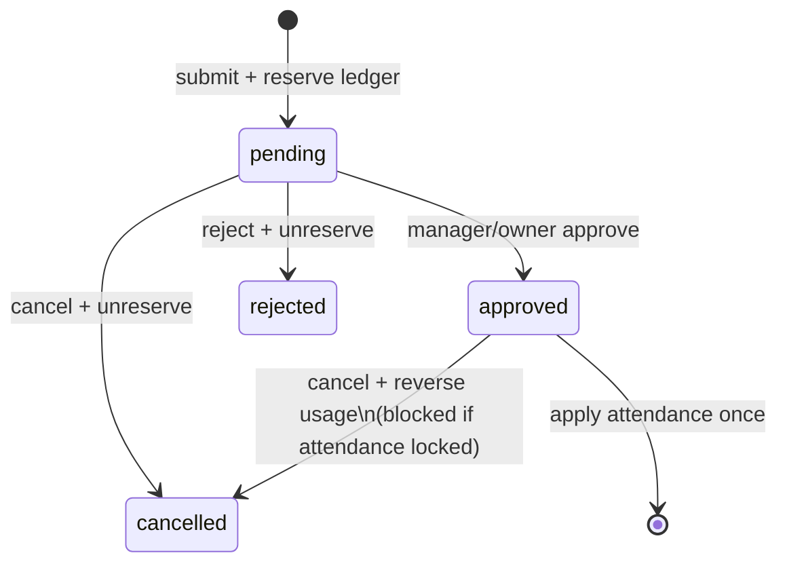

# DigiCRM × HRMS — System Guide

## 1. Product purpose and boundaries

DigiCRM is a **Marketing Agency Operating System** (clients, campaigns, tasks, time tracking, commercial, leads). HRMS is an **integrated people layer** for the same agency users:

| In HRMS | Out of scope / separate |
|---------|-------------------------|
| Employees, org units, attendance punches, leave ledger, expense claims, payroll drafts | CRM `time_entries` (billable timers) |
| Approvals for leave/expense | Client content approvals |
| Private employee documents | `client_files` |
| Operational readiness dashboards | Invented statutory PF/ESI/TDS rates |
| | Real bank payment initiation |

Influencer appears only as **campaign/deliverable type enums**, not a separate CRM.

## 2. Architecture and code map

| Layer | Location |
|-------|----------|
| Config | `config/hrms.php` |
| Migrations | `database/migrations/2026_10_12_100000_*` … `120100_*` |
| Models | `app/Models/{Company,Employee,Attendance*,Leave*,Payroll*,Expense*,…}` |
| Services | `app/Services/Hr/*` |
| Policies | `app/Policies/{Employee,LeaveRequest,AttendancePunch}Policy.php` |
| HTTP | `app/Http/Controllers/Hr/*`, routes under `/hr` in `routes/web.php` |
| UI | `resources/js/Pages/Hr/**` |
| Seed | `HrDemoSeeder` via `DatabaseSeeder` |
| Tests | `tests/Feature/Hr/**` |

**Pattern:** Controllers authorize → Services hold rules → Policies gate records → `ActivityLogger` audits.

## 3. Main entities

- **Company** — tenant key (`company_id` on all HR rows). Default seeded from billing/app name.
- **Branch / Department / Designation** — org structure; must match employee’s company.
- **Employee** — employment record; optional unique `user_id` (login).
- **WorkShift / EmployeeShiftAssignment** — effective-dated shifts (fixed/overnight).
- **AttendancePunch** — immutable raw events; **AttendanceDay** — derived daily status.
- **LeaveType / LeaveLedgerEntry / LeaveRequest** — configurable types + ledger + workflow.
- **ApprovalRequest / ApprovalAction** — polymorphic approvals (no self-approve).
- **ExpenseClaim / ExpenseCategory** — reimbursement lifecycle separate from salary.
- **SalaryStructure / EmployeeSalaryAssignment / PayrollRun / PayrollItem** — draft→lock payroll.
- **EmployeeDocument*** — private disk storage.

## 4. Company / branch isolation

- Every HR write validates org FKs belong to the employee’s `company_id`.
- List/show scopes: `view_all` → company; `view_team` → direct reports + self; else self.
- **Limitation:** `super_admin` Gate::before returns true for most abilities (CRM heritage). Multi-company owner switching is not implemented.

## 5. Roles and permissions

| Product role | Typical Spatie mapping | Notes |
|--------------|------------------------|-------|
| Owner | `super_admin` (+ all `hr.*`) | Config + payroll |
| Manager | `manager` and/or reporting line + `hr.*.view_team` / approve | No automatic salary access |
| Employee | `team_member` / `employee` + `hr.*.view_own` | Own attendance/leave/docs/expenses |

Key permissions: `hr.employees.*`, `hr.attendance.*`, `hr.leave.*`, `hr.expenses.*`, `hr.payroll.*`, `hr.documents.*`, `hr.approvals.act_as_owner`, `hr.org.manage`.

Managers **do not** receive `hr.salary.manage` / `hr.payroll.view` by default.

## 6. Workflows

### Attendance

1. Punch (`check_in`/`check_out`/breaks) with optional `idempotency_key`.
2. Work date resolved (overnight → prior start day).
3. `AttendanceDay` derived: worked minutes, late/early, missing checkout, status.
4. Locked days reject new punches.
5. Inactive/exited employees and pre-join / post-exit dates rejected.

**Actual:** Missing checkout → `exception` (not automatic LOP).  
**Actual:** Client-supplied `punched_at` accepted if ordering rules pass (no skew limit).

### Leave

- Pending requests **reserve** balance (negative ledger).
- Approve: unreserve + usage; apply attendance with `leave_fraction` (1.0 or 0.5).
- Same calendar day: `first_half` + `second_half` allowed; same half or `full_day` conflicts.
- Comp-off requires unique `comp_off_attendance_day_id`.

### Payroll

- Inputs: salary assignment, calendar payable days (join/exit clipped), LOP = Σ absent(1) + unpaid_leave(`leave_fraction`).
- BCMath money; statutory snapshot `not_configured`.
- Status: `draft` → `review` → `approved` → `locked`.
- Scheduled expenses (same currency) link `via_payroll` once; direct `markPaid` then blocked.
- **Locked runs cannot regenerate.** Post-lock leave cancel blocked; adjustment module not built.

### Expenses

`draft` → `submitted` → `approved` → `scheduled`/`paid` (or `via_payroll`).  
Approval ≠ payment. Amount must be &gt; 0 and ≤ category max.

### Documents

Private `local` disk under `hr/employee-documents/{company}/{employee}`. MIME allow-list; filename sanitized. Download authorization in service (HTTP route still to wire).

### Tasks (CRM)

Existing CRM tasks unchanged. Completion does **not** write attendance or payroll. Recurrence / leave-conflict surfacing not implemented.

## 7. Notifications, jobs, audit

- **Audit:** `ActivityLogger` (`module=hr`) on employee/leave/payroll/expense/document actions.
- **Notifications:** Not required for HR commits; Phase 9 stack available for future events.
- **Jobs:** No dedicated HR queue workers yet (accrual, reminders, biometric import).

## 8. Configuration

| Key | Purpose |
|-----|---------|
| `config/hrms.php` | Enums, default attendance thresholds/timezone |
| Company.timezone / Employee.timezone | Punch localization |
| LeaveType flags | paid, negative balance, comp-off, (holiday flags unused in calc) |
| WorkShift minutes/grace | Day classification |

## 9. Known limitations

See gap analysis checklist and edge-case matrix. Highest residual risks: no post-lock adjustment runs, no statutory engine, super-admin tenant bypass, incomplete expense/document UI routes, leave holiday counting unused, no true multi-process concurrency proofs.
